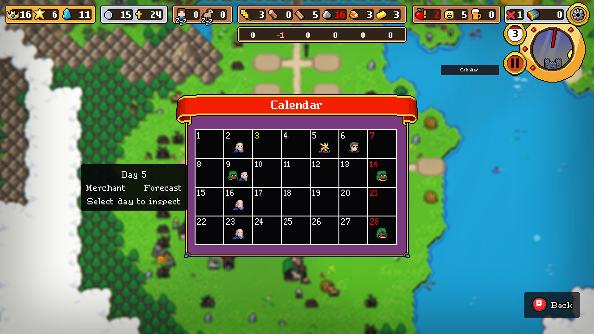
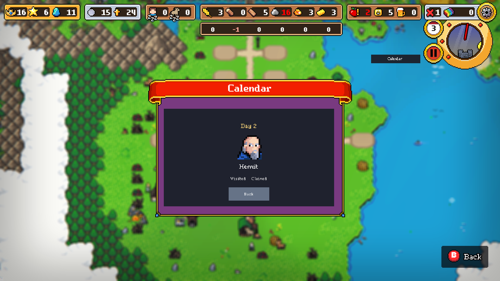

# Visitor Calendar

See today’s visitors beside the day display and inspect their portraits in the game’s Calendar. Select a date to see who came, whether you took their offer, or which known visitor is expected next. Undiscovered encounters stay hidden.



*On day 3, the day-5 Merchant is still a forecast. Day 9 has room for both the Witch Doctor and the Weekly Hermit.*



*Selecting day 2 shows the Hermit’s recorded visit and claim. Both screenshots use the game’s 1.5× UI scale with simulated controller input.*

## Reading the Calendar

| Status | What it tells you |
|---|---|
| **Forecast** | A known visitor has an eligible booking. |
| **Visited** | The visitor arrived. A declined offer also counts as a visit. |
| **Claimed Today** | You took this visitor’s offer today. |
| **Visited · Claimed** | You took the offer on a previous day. |

The calendar records visits from installation onward. Continue restores the history for the matching kingdom checkpoint, including visits carried through the tavern to the next dawn. History is stored in the mod profile’s `BepInEx/config/VisitorCalendar` folder. If you move a save to another mod profile, copy that folder too.

## Controls

- **Open Calendar** from the map with **Game/Calendar**. The defaults are **K** on keyboard and **D-pad Up** on controller. You can also click the day badge.
- **Inspect a date** by moving to it and pressing the game’s **Submit** action, or by clicking it. Use **Previous** and **Next** to inspect multiple visitors on the same date.
- **Return** with the controller’s **Back** action, the on-screen **Back** button in appointment details, or the keyboard **Overlay/Calendar** binding. Back from an appointment restores focus to that date. Closing the grid returns to the previous HUD selection when available.
- The map and overlay have separate keyboard bindings. If you remap only **Game/Calendar** to **X**, **X** opens the calendar and the default **K** returns from the detail or grid. The badge shows a shortcut when the native day button can open the calendar.

## Mod compatibility

- **Weekly Hermit** supplies its configured repeat interval in ordinary kingdoms. A repeat appointment appears on the current day once an eligible recruit offer opens. A blessing narrated by the Hermit leaves the visit and claim records alone.
- **Daily Caravan** supplies its configured first supplemental day and respects the native unlocks. Replaying a dawn with a recorded decline shows **Visited**. A restored reward selection counts as a claim.
- **Kingdom Charters** can move the Merchant charter’s first Caravan one day earlier when the gate is open and the guest slot is free. The calendar withholds that booking while both dates are possible. Daily Caravan takes scheduling precedence when installed.
- **Weekly Contracts** retains its calendar link. For other guest mods, Visitor Calendar reads observed scheduler dates, invitations, game portraits and localized names. An unfamiliar arrival hook defers affected forecasts until an arrival is observed. A missing portrait gets a dot, and the appointment detail still shows the visitor’s name when available.

## Installation

Use a Super Fantasy Kingdom profile in Thunderstore Mod Manager or r2modman. Install **VisitorCalendar** with the BepInEx dependencies listed in its manifest and start the game modded. For a local ZIP, use the profile’s **Import local mod** option and select `VisitorCalendar-0.1.0.zip`.

## Build and package

From the repository root with the .NET SDK and Python 3 installed:

```powershell
dotnet build VisitorCalendar.csproj -c Release
dotnet run --project tests/CalendarChecks.csproj -c Release
python package.py
```

The projects default to the local Steam game and the Daybook Dev profile for build references. Override `GameDir` and `ProfileDir` with MSBuild properties for another installation. Packaging writes `dist/VisitorCalendar-0.1.0.zip`.

To compare the calendar with specific companion builds, pass the VisitorCalendar, WeeklyHermit and DailyCaravan DLL paths after `--` on the test command. Append the KingdomCharters DLL path to exercise the Merchant charter's first-visit policy and its interaction with Daily Caravan.

## Contributing and license

Bug reports and pull requests are welcome. See the [contribution guide](https://github.com/GKJ-Super-Fantasy-Kingdom/visitor-calendar/blob/main/CONTRIBUTING.md) for local testing and reporting instructions.

The original mod code is available under the [MIT License](https://github.com/GKJ-Super-Fantasy-Kingdom/visitor-calendar/blob/main/LICENSE). Super Fantasy Kingdom, its game assets, and third-party dependencies retain their respective licenses and ownership.
