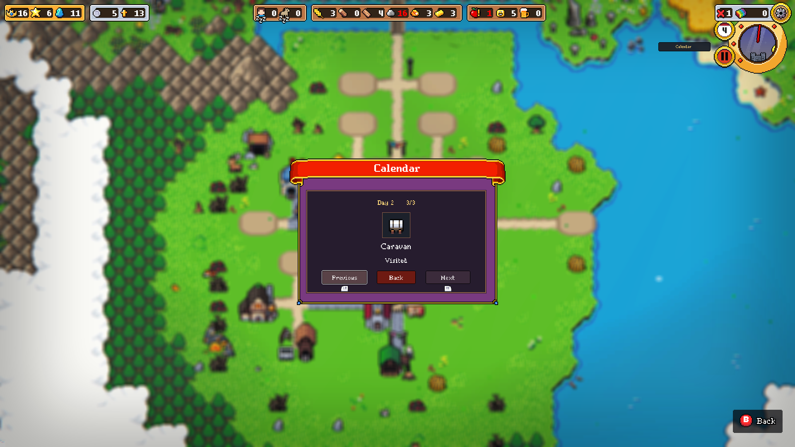
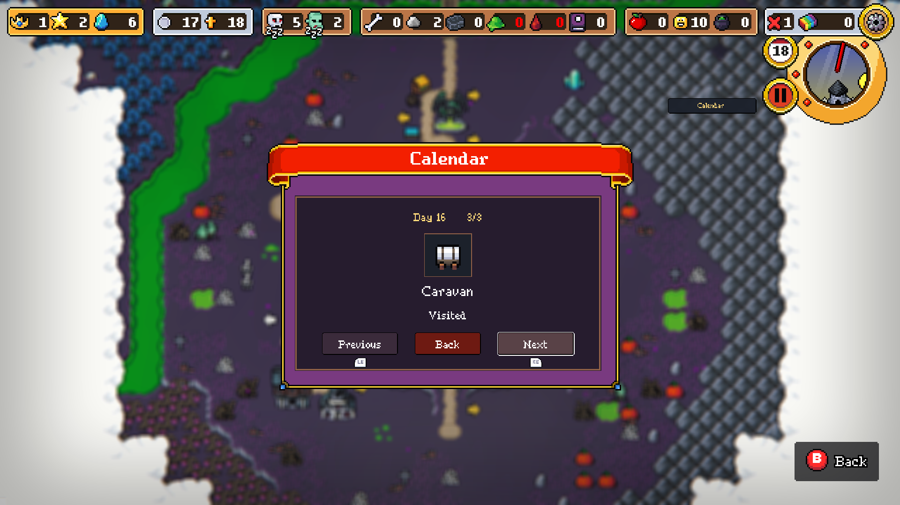

# Visitor Calendar

Open the calendar beside the day display to see when familiar visitors are expected. Return to an earlier date to see who actually came and whether you took their offer.

## Features

- Select an upcoming portrait to see **Forecast**. A forecast can change when a visitor’s schedule changes. Undiscovered encounters stay hidden.
- Check an earlier date for **Visited** if the visitor arrived, even if you declined. Taking an offer shows **Claimed Today** that day and **Visited · Claimed** on later days. Past dates without a recorded visit stay empty, even if you later enable daily wagons.
- A gold **!** marks a contract deadline. A chest marks a prepaid commission. Both can share a date with a visitor. If the caravan date is unknown, look for **Next Caravan** above the grid.
- Visit history starts when you install the mod. Using **Continue** restores the visits recorded for that kingdom’s saved checkpoint. If you move the save to another mod profile, copy its `BepInEx/config/VisitorCalendar` folder too.
- A white edge shows which appointment date or detail button is active. Returning from the details keeps the inspected date selected.

## How to Use

1. From the map, click the calendar badge beside the day display, press **K**, or press **D-pad Up**. These are the default bindings.
2. Click a date with a portrait or delivery marker, or move to it with the arrow keys or D-pad and confirm with **Enter** or **A** on an Xbox layout. If visitors or deliveries share the date, use **Previous** and **Next** to inspect each entry. The details show shortcuts when **Overlay/Left** and **Overlay/Right** are bound for your current input device.
3. Choose **Back**, press **B** on an Xbox layout, or use the calendar overlay key (default **K**) to return to that date. Go back again to close the grid and return to the previous selection when available. The map shortcut (`Game/Calendar`) and overlay shortcut (`Overlay/Calendar`) can be rebound separately.

## Screenshots

*Human, 1× UI scale. The Day 2 caravan is marked **Visited**, with controller focus on **Previous**.*

*Undead, 1.5× UI scale. The Day 16 caravan is the third entry on that date. Controller focus is on **Next**.*

Captured on Super Fantasy Kingdom 0.8.070 with the controller-tested Visitor Calendar 0.1.3 build, using copied saves and a virtual Xbox controller. The 0.1.4 release changes the version metadata and carries over the same gameplay code.

## Compatibility

- Verified on Super Fantasy Kingdom **0.8.070**. Companion mods are optional.
- In ordinary kingdoms, [Weekly Hermit](https://thunderstore.io/c/super-fantasy-kingdom/p/GKJ/WeeklyHermit/) sets the interval between repeat visits. On the day of a repeat visit, the Hermit appears once a recruit offer opens.
- [Daily Caravan](https://thunderstore.io/c/super-fantasy-kingdom/p/GKJ/DailyCaravan/) sets the first extra caravan day in ordinary kingdoms. Forecasts follow its `FirstDay` and `AllowBeforeGiantGate` settings and the game's caravan progression. Earlier missed dates stay empty. After reloading a dawn, a recorded decline still counts as a visit and a selected reward counts as a claim.
- The Merchant charter in [Kingdom Charters](https://thunderstore.io/c/super-fantasy-kingdom/p/GKJ/KingdomCharters/) can bring the first caravan one day early if the gate is open and the guest slot is free. The calendar waits until the date is settled. [Daily Caravan](https://thunderstore.io/c/super-fantasy-kingdom/p/GKJ/DailyCaravan/) takes precedence if both are installed.
- With [Weekly Contracts](https://thunderstore.io/c/super-fantasy-kingdom/p/GKJ/WeeklyContracts/) 0.1.2 or later, **Delivery Due** appears on the accepted contract’s deadline until you deliver or the contract expires. Inspect the entry for the order, quantity and resource. The calendar’s contract button still opens the contract.
- With [Caravan Commissions](https://thunderstore.io/c/super-fantasy-kingdom/p/GKJ/CaravanCommissions/) 0.1.1 or later, an outstanding prepaid order shows **Commission Forecast** on the next known item-caravan date. An earlier invitation can change when it arrives. **Commission Delivery** means today’s item caravan can fulfill the order. If the date is unknown, **Next Caravan** stays separate from the dated visits.
- With LowEyeCue’s [Berry God’s Blessing](https://thunderstore.io/c/super-fantasy-kingdom/p/LowEyeCue/BerryGodsBlessing/) 0.1.0, the Hermit can announce a blessing. That announcement alone leaves the calendar and claim history unchanged.
- With ownlyme’s [Right Click Skip](https://thunderstore.io/c/super-fantasy-kingdom/p/ownlyme/RightClickSkip/) 1.2.0, skipping the new-day caption leaves the day’s appointments visible. An offer is marked claimed only when you take it.
- For other guest mods, the calendar forecasts a date only when it can identify a reliable booking. A known visitor can still appear after an observed arrival. If a portrait is missing, look for a small diamond on the date.

## Installation

1. Open Thunderstore Mod Manager or r2modman and select your Super Fantasy Kingdom profile.
2. Install **VisitorCalendar** with its listed dependencies, [BepInExPack](https://thunderstore.io/c/super-fantasy-kingdom/p/BepInEx/BepInExPack/) and [HideManagerGameObject Config](https://thunderstore.io/c/super-fantasy-kingdom/p/BepInEx/HideManagerGameObject_Config/). If you have the local ZIP, use **Import local mod** in that profile.
3. Start the game modded and look for the calendar badge beside the day display once your kingdom loads.

Bug reports and pull requests are welcome. See the [contribution guide](https://github.com/GKJ-Super-Fantasy-Kingdom/visitor-calendar/blob/main/CONTRIBUTING.md) for local testing and reporting instructions.

The original mod code is available under the [MIT License](https://github.com/GKJ-Super-Fantasy-Kingdom/visitor-calendar/blob/main/LICENSE). Super Fantasy Kingdom, its game assets, and third-party dependencies retain their respective licenses and ownership.

## Support

[Support GKJ Games on Ko-fi](https://ko-fi.com/gkj_games)
