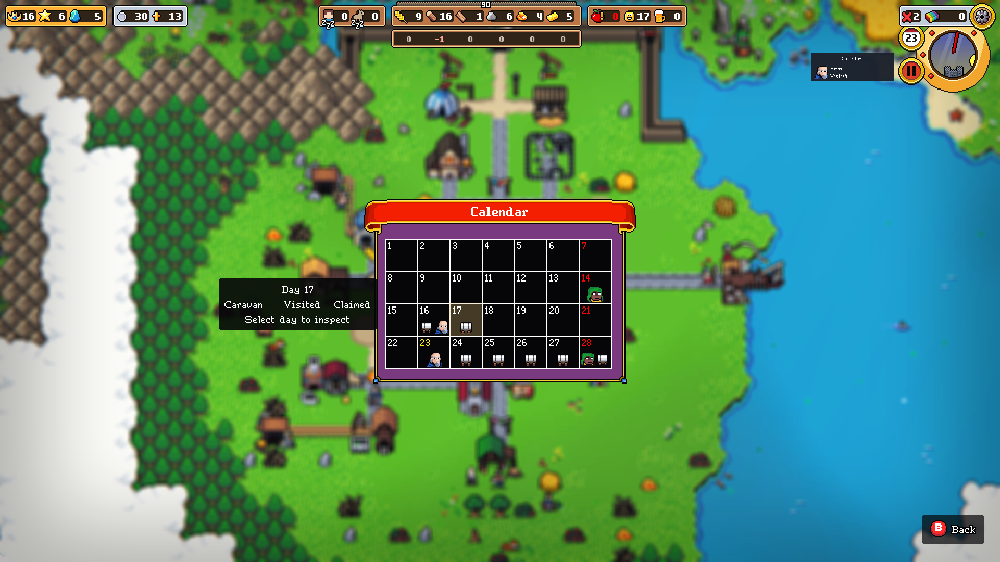
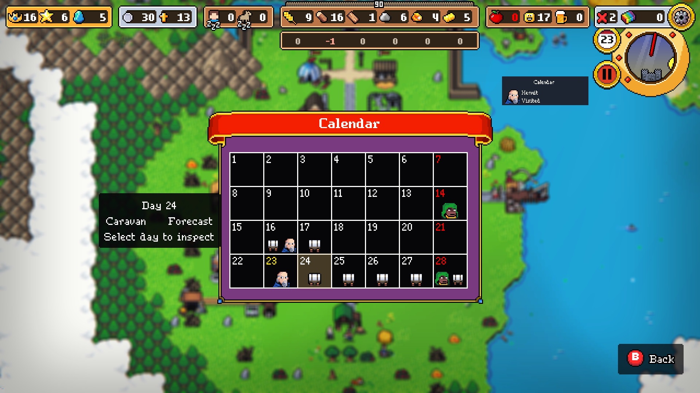

# Visitor Calendar

Open the calendar beside the day display to see when familiar visitors are expected. Return to an earlier date to see who actually came and whether you took their offer.

## Features

- Select an upcoming portrait to see **Forecast**. A forecast can change when a visitor’s schedule changes. Undiscovered encounters stay hidden.
- Check an earlier date for **Visited** if the visitor arrived, even if you declined. Taking an offer shows **Claimed Today** that day and **Visited · Claimed** on later days. Past dates without a recorded visit stay empty, even if you later enable daily wagons.
- A gold **!** marks a contract deadline. A chest marks a prepaid commission. Both can share a date with a visitor. If the caravan date is unknown, look for **Next Caravan** above the grid.
- Visit history starts when you install the mod. Using **Continue** restores the visits recorded for that kingdom’s saved checkpoint. If you move the save to another mod profile, copy its `BepInEx/config/VisitorCalendar` folder too.

## How to Use

1. From the map, click the calendar badge beside the day display, press **K**, or press **D-pad Up**. These are the default bindings.
2. Click a date with a portrait or delivery marker, or move to it with the arrow keys or D-pad and confirm with **Enter** or **A** on an Xbox layout. If visitors or deliveries share the date, use **Previous** and **Next** to inspect each entry.
3. Choose **Back**, press **B** on an Xbox layout, or use the calendar overlay key (default **K**) to return to that date. Go back again to close the grid and return to the previous selection when available. The map shortcut (`Game/Calendar`) and overlay shortcut (`Overlay/Calendar`) can be rebound separately.

## Screenshots

*1× UI scale. The caravan came on day 17 and the player took its offer. Days 18–22 have no recorded visits.*

*1.5× UI scale. Day 24 is the first eligible daily wagon in this kingdom. Its portrait shows what is expected tomorrow. Today’s day-23 badge shows the Hermit.*

For an eligible kingdom with `FirstDay = 24` and the early-gate option on, the forecast starts on Day 24.

## Compatibility

- Works with Super Fantasy Kingdom **0.8.068** and the other [GKJ mods](https://thunderstore.io/c/super-fantasy-kingdom/p/GKJ/).
- [Weekly Hermit](https://thunderstore.io/c/super-fantasy-kingdom/p/GKJ/WeeklyHermit/) repeat visits and [Daily Caravan](https://thunderstore.io/c/super-fantasy-kingdom/p/GKJ/DailyCaravan/) forecasts follow their schedules. The caravan forecast uses the configured first day, early-gate option, and kingdom progression. Unrecorded past dates stay empty.
- The Merchant Charter in [Kingdom Charters](https://thunderstore.io/c/super-fantasy-kingdom/p/GKJ/KingdomCharters/) can move the first caravan forward when eligible. Daily Caravan takes precedence when both are installed.
- [Weekly Contracts](https://thunderstore.io/c/super-fantasy-kingdom/p/GKJ/WeeklyContracts/) 0.1.2 or later shows **Delivery Due** on the accepted contract’s deadline. [Caravan Commissions](https://thunderstore.io/c/super-fantasy-kingdom/p/GKJ/CaravanCommissions/) 0.1.1 or later shows the next known delivery date, or **Next Caravan** when the date is unknown.
- [Berry God's Blessing](https://thunderstore.io/c/super-fantasy-kingdom/p/LowEyeCue/BerryGodsBlessing/) can announce a blessing without adding a visit or claim to the calendar.
- With [Right Click Skip](https://thunderstore.io/c/super-fantasy-kingdom/p/ownlyme/RightClickSkip/), skipping the dawn caption leaves appointments visible. For other mods, the calendar needs a known schedule or an observed visit.
- These community mods can share the same profile. [Achievement Enabler](https://thunderstore.io/c/super-fantasy-kingdom/p/ownlyme/AchievementEnabler/), [Bakery Uses Wheat](https://thunderstore.io/c/super-fantasy-kingdom/p/ownlyme/BakeryUsesWheat/), [More Relics](https://thunderstore.io/c/super-fantasy-kingdom/p/ownlyme/MoreRelics/), [Right Click Skip](https://thunderstore.io/c/super-fantasy-kingdom/p/ownlyme/RightClickSkip/), and [Tavern Food Priorities](https://thunderstore.io/c/super-fantasy-kingdom/p/ownlyme/TavernFoodPriorities/).

## Installation

1. Open Thunderstore Mod Manager or r2modman and select your Super Fantasy Kingdom profile.
2. Install **VisitorCalendar** with its listed dependencies, [BepInExPack](https://thunderstore.io/c/super-fantasy-kingdom/p/BepInEx/BepInExPack/) and [HideManagerGameObject Config](https://thunderstore.io/c/super-fantasy-kingdom/p/BepInEx/HideManagerGameObject_Config/). If you have the local ZIP, use **Import local mod** in that profile.
3. Start the game modded and look for the calendar badge beside the day display once your kingdom loads.

## Support

[Support GKJ Games on Ko-fi](https://ko-fi.com/gkj_games)
