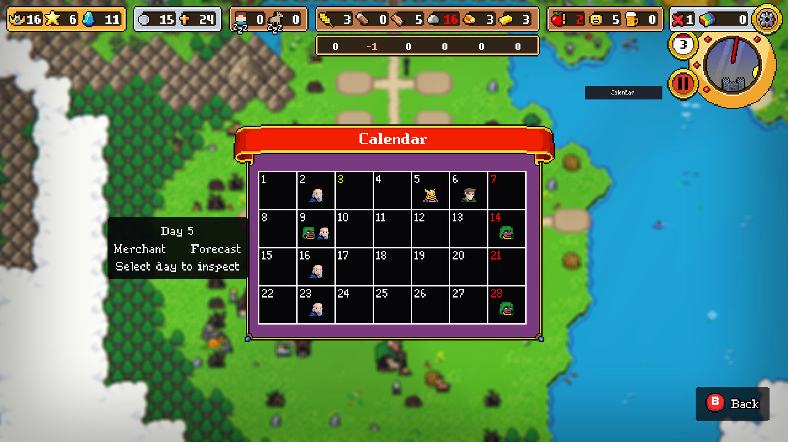

Open the in-game calendar to see when familiar visitors are due, or glance beside the day display to see who is on today’s schedule. After a visit, the calendar remembers who came and whether you took their offer.

## Features

- Look for portraits on upcoming dates. **Forecast** means a known visitor is expected. Undiscovered encounters stay hidden.
- Check an earlier date for **Visited** if the visitor arrived, even if you declined. Taking an offer shows **Claimed Today** that day and **Visited · Claimed** on later days.
- Visit history starts when you install the mod. Using **Continue** restores the visits recorded for that kingdom’s saved checkpoint.

## How to Use

1. From the map, click the calendar badge beside the day display, press **K**, or press **D-pad Up**. These are the default bindings.
2. Click a date with a portrait, or move to it with the arrow keys or D-pad and confirm with **Enter** or **A** on an Xbox layout. If several visitors share the date, use **Previous** and **Next** to inspect each one.
3. Choose **Back**, press **B** on an Xbox layout, or use the calendar overlay key (default **K**) to return to that date. Go back again to close the grid and return to the previous selection when available. The map and overlay keyboard shortcuts can be rebound separately.

## Screenshots

*The day 5 tooltip identifies the Merchant as a forecast. Two portraits share day 9.*

*Looking back from day 3, you can see that you took the Hermit’s offer on day 2.*

Both screenshots were captured in-game with Visitor Calendar 0.1.0 at 1.5× UI scale using simulated controller input.

## Compatibility

Visitor Calendar works on its own. In ordinary kingdoms, it follows the configured schedules from **Weekly Hermit** and **Daily Caravan** and respects caravan unlocks. It also accounts for the Merchant charter’s early caravan in **Kingdom Charters**. With Daily Caravan installed, its schedule takes precedence. **Weekly Contracts** keeps its calendar link.

For other guest mods, forecasts depend on whether the calendar can identify a reliable booking. A visitor with an unknown schedule can still appear after an observed arrival. If a portrait is missing, look for a dot on the date.

## Installation

Select your Super Fantasy Kingdom profile in Thunderstore Mod Manager or r2modman. Install **VisitorCalendar** with its listed **BepInExPack** and **HideManagerGameObject Config** dependencies, then start the game modded.
